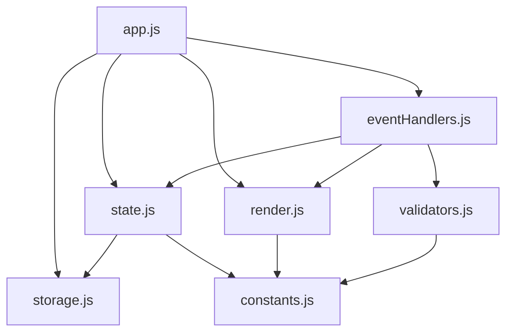
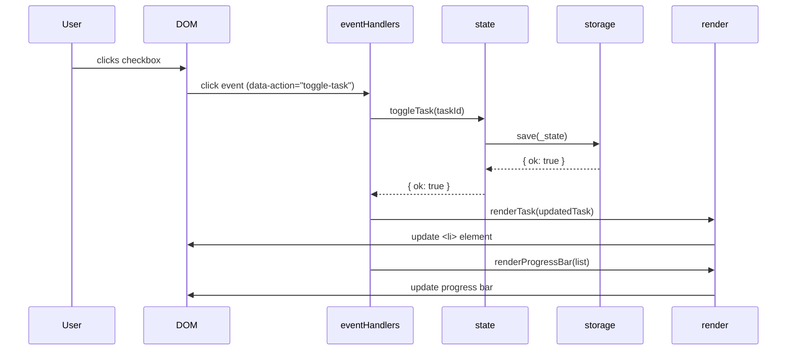

# Design Document

## Overview

The To Do List Life Dashboard is a single-page web application (SPA) built with HTML, CSS, and Vanilla JavaScript — no frameworks, no build step, no server. All data is persisted in `localStorage`. The application loads from a static `index.html` file (or a small directory of static files) and runs entirely in the user's browser.

The design philosophy is to keep all state in a single in-memory object (the **App State**), synchronise it to `localStorage` on every mutation, and re-render only the affected portions of the DOM. This avoids the complexity of a virtual DOM while keeping the application responsive and predictable.

**Key goals:**
- Complete functionality with zero external dependencies
- Deterministic data flow: mutate state → persist → render
- WCAG 2.1 AA accessibility out of the box
- Responsive layout from 320 px to 2560 px with no JavaScript breakpoint logic (CSS-only)

---

## Architecture

### File Structure

```
index.html          ← entry point; links stylesheet and module scripts
css/
  styles.css        ← all CSS: custom properties, layout, components, responsive
js/
  app.js            ← bootstrap: load state, wire events, initial render
  state.js          ← in-memory state object + all mutation functions
  storage.js        ← localStorage read/write/error handling
  render.js         ← DOM rendering functions (stateless: data in → DOM out)
  eventHandlers.js  ← all user-interaction event handlers
  validators.js     ← pure validation functions (no DOM side-effects)
  constants.js      ← STORAGE_KEY, DEFAULT_CATEGORIES, length limits
```

All JS files are loaded as ES modules (`type="module"`). `app.js` is the sole entry point; it imports from the other modules but nothing outside this directory is needed.

### Data Flow

```
User Action
    │
    ▼
eventHandlers.js  ──validate──▶ validators.js
    │
    ▼  (on valid input)
state.js  (mutate in-memory state)
    │
    ├──▶ storage.js  (write to localStorage; handle quota / unavailability)
    │
    └──▶ render.js   (update DOM with new state)
```

No asynchronous operations are involved. Every mutation completes synchronously within a single event handler call, ensuring the 100 ms UI-update budget (Requirement 11.2) is always met.

### Module Responsibilities

| Module | Responsibility |
|---|---|
| `constants.js` | Immutable values: `STORAGE_KEY`, `DEFAULT_LIFE_CATEGORIES`, field length limits |
| `validators.js` | Pure functions that return `{ valid: boolean, message: string }` |
| `storage.js` | `load()`, `save(state)`, `isAvailable()` — all `localStorage` interactions |
| `state.js` | The canonical in-memory state; exports mutation functions that call `storage.save()` |
| `render.js` | Stateless DOM builders; called with a snapshot of state; no direct mutation |
| `eventHandlers.js` | Bridges DOM events to state mutations and render calls |
| `app.js` | Bootstraps the app: load → render → attach event listeners |

---

## Components and Interfaces

### UI Component Hierarchy

```
<body>
└── #app
    ├── <header>  ─── App title, global "Add Life Category" button
    ├── <main>
    │   └── #dashboard-grid  ─── CSS Grid container
    │       └── .life-category-panel  [×N]
    │           ├── .category-header  (name, progress bar, delete/edit if custom)
    │           └── .task-list-container
    │               └── .task-list-card  [×M]
    │                   ├── .task-list-header  (name, progress bar, rename/delete)
    │                   ├── .filter-sort-bar   (All/Active/Completed, sort select)
    │                   ├── .task-items        (ul)
    │                   │   └── .task-item  [×K]
    │                   │       ├── <input type="checkbox">
    │                   │       ├── <span class="task-title">
    │                   │       ├── <span class="task-due-date">
    │                   │       └── .task-actions  (edit, delete buttons)
    │                   └── .add-task-form     (input, date, submit)
    └── <aside id="modal-overlay">  ─── confirmation dialogs, edit forms
```

### JavaScript Module Interfaces

#### `constants.js`
```js
export const STORAGE_KEY = 'todoLifeDashboard_v1';
export const DEFAULT_LIFE_CATEGORIES = ['Personal', 'Work', 'Health', 'Finance'];
export const MAX_TASK_TITLE_LENGTH = 255;
export const MAX_LIST_NAME_LENGTH = 100;
export const MAX_CATEGORY_NAME_LENGTH = 50;
```

#### `validators.js`
```js
export function validateTaskTitle(title)       // { valid, message }
export function validateDueDate(dateStr)        // { valid, message }
export function validateListName(name)          // { valid, message }
export function validateCategoryName(name)      // { valid, message }
```

#### `storage.js`
```js
export function isAvailable()                  // boolean
export function load()                         // AppState | null
export function save(state)                    // { ok: boolean, error?: string }
```

#### `state.js`
```js
export function getState()                     // deep clone of AppState
// Life Category mutations
export function createCategory(name)           // { ok, id?, error? }
export function deleteCategory(id)             // { ok, error? }
// Task List mutations
export function createTaskList(name, categoryId)  // { ok, id?, error? }
export function renameTaskList(id, name)           // { ok, error? }
export function deleteTaskList(id)                 // { ok, error? }
// Task mutations
export function createTask(title, dueDate, listId) // { ok, id?, error? }
export function updateTask(id, title, dueDate)     // { ok, error? }
export function toggleTask(id)                     // { ok, error? }
export function deleteTask(id)                     // { ok, error? }
// UI state mutations (filter/sort — not persisted)
export function setFilter(listId, filter)
export function setSort(listId, sort)
```

#### `render.js`
```js
export function renderDashboard(state)         // full re-render (on load)
export function renderCategory(categoryData)   // returns <section> Element
export function renderTaskList(listData, tasks, uiState)  // returns <div> Element
export function renderTask(taskData)           // returns <li> Element
export function renderProgressBar(completed, total) // returns <div> Element
export function showInlineError(inputEl, message)
export function clearInlineError(inputEl)
export function showModal(config)              // confirmation/edit overlays
export function hideModal()
export function showStorageWarning(message)    // non-blocking banner
```

#### `eventHandlers.js`
```js
export function onAddTask(event)
export function onToggleTask(event)
export function onEditTask(event)
export function onDeleteTask(event)
export function onAddTaskList(event)
export function onRenameTaskList(event)
export function onDeleteTaskList(event)
export function onAddCategory(event)
export function onDeleteCategory(event)
export function onFilterChange(event)
export function onSortChange(event)
export function onConfirmModal(event)
export function onCancelModal(event)
```

---

## Data Models

### In-Memory AppState Shape

```js
{
  categories: [
    {
      id: string,          // UUID v4, e.g. "a1b2c3d4-..."
      name: string,        // 1–50 chars
      isDefault: boolean   // true for Personal/Work/Health/Finance
    }
  ],
  taskLists: [
    {
      id: string,          // UUID v4
      name: string,        // 1–100 chars
      categoryId: string   // foreign key → categories[].id
    }
  ],
  tasks: [
    {
      id: string,          // UUID v4
      title: string,       // 1–255 chars
      dueDate: string | null, // "YYYY-MM-DD" or null
      completed: boolean,
      listId: string,      // foreign key → taskLists[].id
      createdAt: number    // Date.now() timestamp (ms since epoch)
    }
  ]
}
```

**UI state** (filter/sort selections) is kept only in memory and is not persisted to `localStorage`, since it reflects transient user preference within a session:

```js
// Maintained in state.js alongside AppState
{
  uiState: {
    [listId]: {
      filter: 'all' | 'active' | 'completed',
      sort: 'creation' | 'dueDate'
    }
  }
}
```

### localStorage Schema

All data is stored under a single namespaced key (Requirement 8.4):

```
Key:   "todoLifeDashboard_v1"
Value: JSON.stringify(AppState)
```

The `v1` suffix in the key allows future schema migrations without reading stale data.

**Example stored value (abbreviated):**
```json
{
  "categories": [
    { "id": "cat-1", "name": "Work", "isDefault": true }
  ],
  "taskLists": [
    { "id": "list-1", "name": "Sprint Tasks", "categoryId": "cat-1" }
  ],
  "tasks": [
    {
      "id": "task-1",
      "title": "Write design doc",
      "dueDate": "2026-11-16",
      "completed": false,
      "listId": "list-1",
      "createdAt": 1731715200000
    }
  ]
}
```

### ID Generation

UUIDs are generated with `crypto.randomUUID()`, available without polyfills in all target browsers (Chrome 92+, Firefox 95+, Edge 92+, Safari 15.4+). All target browsers in Requirement 12.1 ship versions well above these thresholds.

### Default Data Seeding

On first load (empty `localStorage`), `app.js` seeds the four built-in `Life_Categories` (Personal, Work, Health, Finance) with `isDefault: true`. These categories are excluded from deletion and rename controls in `render.js`.

---

## State Management Approach

State lives in a single module-level variable inside `state.js`:

```js
let _state = { categories: [], taskLists: [], tasks: [] };
```

All reads go through `getState()`, which returns a deep clone so callers cannot mutate internal state directly. All writes go through the named mutation functions, which follow this pattern:

```js
export function toggleTask(id) {
  const task = _state.tasks.find(t => t.id === id);
  if (!task) return { ok: false, error: 'Task not found' };
  task.completed = !task.completed;
  const result = storage.save(_state);
  return result.ok ? { ok: true } : { ok: false, error: result.error };
}
```

Callers (event handlers) check the return value and either re-render or display an error. This keeps error handling explicit and co-located with the event handler that knows which UI element to update.

**Render strategy:** After each mutation, `eventHandlers.js` calls the smallest `render.*` function that covers the changed scope — a single task item re-render for a toggle, a full task list re-render for a sort change. `renderDashboard()` is only called on initial load.

---

## Event Handling Patterns

All event listeners are attached once in `app.js` via event delegation on the `#app` root element. Handlers identify their target using `data-*` attributes:

```html
<button data-action="delete-task" data-task-id="task-1" aria-label="Delete task">…</button>
<input  data-action="toggle-task" data-task-id="task-1" type="checkbox">
```

The root listener dispatches to the appropriate handler:

```js
document.getElementById('app').addEventListener('click', (e) => {
  const action = e.target.closest('[data-action]')?.dataset.action;
  if (action) handlers[action]?.(e);
});
```

`submit` events on forms are caught similarly using `data-form` attributes. This pattern avoids memory leaks from listeners attached to dynamically created elements.

---

## Error Handling

### localStorage Unavailability

`storage.isAvailable()` performs a probe write/read/delete to detect `SecurityError` (private browsing restrictions) or quota exhaustion:

```js
export function isAvailable() {
  try {
    localStorage.setItem('__probe__', '1');
    localStorage.removeItem('__probe__');
    return true;
  } catch { return false; }
}
```

**On load failure (Requirement 8.3):** If `load()` throws or returns invalid JSON, `app.js` renders an empty state and displays a non-blocking yellow warning banner: *"Could not load saved data. Starting fresh."*

**On save failure (Requirements 2.5, 3.4, 3.7):** Mutation functions return `{ ok: false, error }`. Event handlers display an inline or modal error message. The in-memory state retains the change so the UI reflects the user's intent for the current session.

**Quota exceeded:** Caught as `QuotaExceededError` inside `storage.save()`. Returns `{ ok: false, error: 'Storage quota exceeded' }` for the caller to surface.

### Validation Errors

`validators.js` returns plain objects — no exceptions. Event handlers call validators before mutating state, display inline error messages via `render.showInlineError()`, and prevent form submission with `event.preventDefault()`.

### Confirmation Prompts

Destructive operations (task delete, list delete, category delete) trigger a modal dialog rendered by `render.showModal()`. The modal sets focus to the confirm button and traps focus within the overlay until dismissed, meeting keyboard-navigation requirements.

---

## Responsive Layout Approach

Layout is handled entirely in CSS using Grid and Flexbox with two breakpoints:

```css
/* Mobile-first base: single column */
#dashboard-grid {
  display: grid;
  grid-template-columns: 1fr;
  gap: 1rem;
}

/* ≥768 px: multi-column grid */
@media (min-width: 768px) {
  #dashboard-grid {
    grid-template-columns: repeat(auto-fill, minmax(320px, 1fr));
  }
}

/* ≥1200 px: allow wider columns */
@media (min-width: 1200px) {
  #dashboard-grid {
    grid-template-columns: repeat(auto-fill, minmax(400px, 1fr));
  }
}
```

All font sizes and spacing use `rem` and `%` units. The root font size inherits from the browser default (16 px) and is never overridden in `px`, satisfying Requirement 10.1 and Requirement 9.4.

Task list cards use `width: 100%` within their grid cell so they fill available space at every viewport width from 320 px to 2560 px.

---

## Accessibility Design

- All interactive elements have visible `:focus-visible` outlines (2 px solid, offset 2 px) — Requirement 10.3.
- Icon-only buttons carry `aria-label` attributes set in `render.js` — Requirement 10.4.
- Colour choices for text/background pairs are validated against WCAG 2.1 AA 4.5:1 contrast in CSS custom properties — Requirement 10.2.
- Progress bars use `role="progressbar"` with `aria-valuenow`, `aria-valuemin="0"`, `aria-valuemax="100"`.
- Modal dialogs use `role="dialog"`, `aria-modal="true"`, and `aria-labelledby` pointing to the dialog title.
- Form inputs are associated with `<label>` elements via `for`/`id` pairs.

---

## Diagrams

### Module Dependency Graph



### Mutation Sequence (Toggle Task)



---

